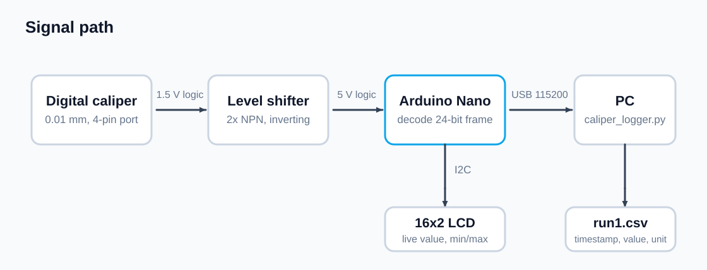
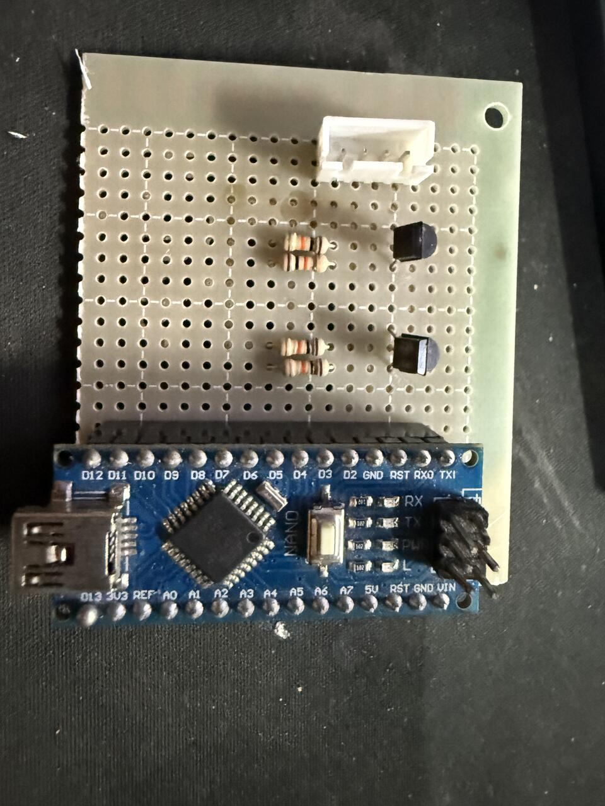
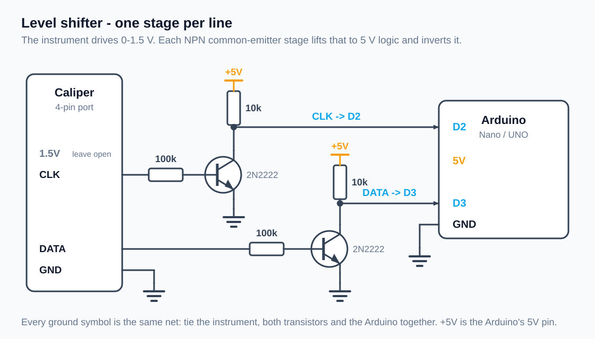
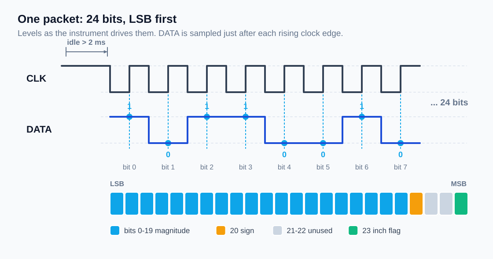
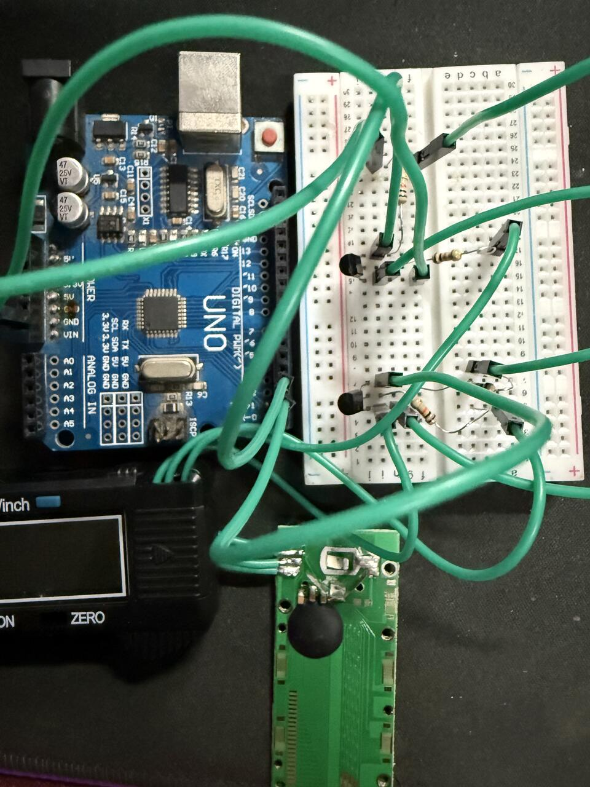
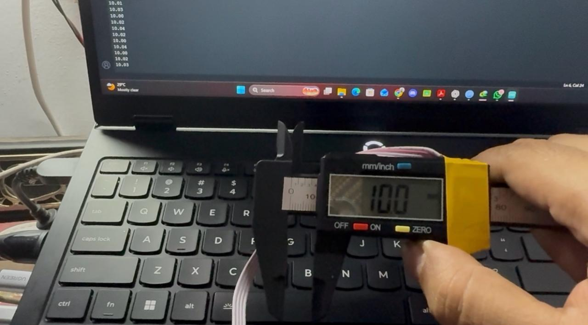

<p align="center">
  
</p>

Read a cheap Chinese digital caliper, dial indicator or micrometer with an
Arduino and get the measurement on your PC — live on the serial port, on a
16x2 LCD, or logged to CSV.

These instruments all carry a 4-pin port that quietly streams the displayed
value as a 24-bit frame at ~1.5 V logic. Two transistors shift it to 5 V and
the Arduino does the rest.





## What is here

```
firmware/
  DialIndicatorReader/       serial only — start here
  DialIndicatorReader_LCD/   16x2 LCD with min/max and a zero button
pc/
  caliper_logger.py          serial -> screen and CSV
docs/
  hardware.md                parts, level shifter, wiring, troubleshooting
  protocol.md                the 24-bit frame, timing, unit conversion
tools/
  make_images.py             regenerates the diagrams in docs/images
```

## Quick start

1. Build the level shifter — two transistors and four resistors, see
   [docs/hardware.md](docs/hardware.md). CLK goes to **D2**, DATA to **D3**,
   grounds tied together.
2. Open `firmware/DialIndicatorReader/DialIndicatorReader.ino`, set
   `RESOLUTION` to `100` for a 0.01 mm instrument or `1000` for a 0.001 mm
   one, and flash it to the Nano.
3. Open the serial monitor at **115200 baud**. Move the slider.



```
10.01 mm
10.03 mm
10.00 mm
 9.98 mm
0.3940 in
```

## Logging to CSV

```
pip install -r pc/requirements.txt

python pc/caliper_logger.py --list
python pc/caliper_logger.py --port COM5 --csv run1.csv
```

Each line becomes `timestamp,value,unit`, flushed as it arrives, so you can
open the file while the run is still going.

## LCD version

`firmware/DialIndicatorReader_LCD` adds a 16x2 display:

```
10.01 mm
L9.98   H10.05
```

Top line is live, bottom line is the lowest and highest reading since the
last reset. A button on **D4** sets the current reading as a relative zero
and clears min/max — handy for run-out and comparative measurements. The
value still goes out over serial, so the logger works unchanged.

## Configuration

Everything worth changing sits at the top of each sketch:

| Setting            | Default | What it does                                |
|--------------------|---------|---------------------------------------------|
| `CLK_PIN`          | 2       | clock input                                 |
| `DATA_PIN`         | 3       | data input                                  |
| `SIGNAL_INVERTED`  | true    | set false if your shifter is non-inverting  |
| `RESOLUTION`       | 100     | 100 = 0.01 mm tools, 1000 = 0.001 mm        |
| `PRINT_UNITS`      | true    | false prints bare numbers                   |
| `IDLE_GAP_US`      | 2000    | quiet time that marks a packet boundary     |

## How it works



The clock idles high between packets. The firmware waits for it to stay
quiet for 2 ms, then clocks in 24 bits LSB-first, sampling DATA after each
rising edge. Bits 0-19 are the count, bit 20 the sign, bit 23 the unit flag,
and the count is divided by 100, 2000, 1000 or 20000 depending on the
resolution and the unit. Full details in [docs/protocol.md](docs/protocol.md).

Framing on the idle gap rather than free-running means a corrupt or
half-caught packet costs one reading, not permanent misalignment.

## Build



Prototyped on an UNO first, then moved onto perfboard as a shield the Nano
plugs into, with the instrument on a 4-pin connector.



Checked against a 10.00 mm gauge block: the reader tracks the caliper's own
display to the last digit.

## Tested with

* Arduino Nano (ATmega328) and Arduino UNO
* Generic 150 mm digital caliper, 0.01 mm
* Windows and the Arduino IDE serial monitor; the Python logger works
  anywhere pyserial does

## Credits

The 24-bit frame format is not my discovery. This implementation was written
against these write-ups and projects, which are worth reading if you want the
background:

* [dialIndicatorToSerial](https://github.com/pawelstawicki/dialIndicatorToSerial)
  by Paweł Stawicki — MIT licensed Arduino reader that samples the lines with
  the ADC instead of a level shifter
* [DialIndicator](https://github.com/dave-herbert/DialIndicator) by Dave
  Herbert — transistor level shifting, interrupt-driven capture and scope
  traces of the protocol
* wei48221's original protocol analysis of Chinese digital calipers
* [Digital dial indicator CNC surface probe](https://hackaday.io/project/511-digital-dial-indicator-cnc-surface-probe)
  on Hackaday.io

## License

MIT — see [LICENSE](LICENSE).

## Author

**Md. Mahin Rahman**
GitHub: [@thisisdibbo](https://github.com/thisisdibbo)
Email: mr.d2003feb@gmail.com
