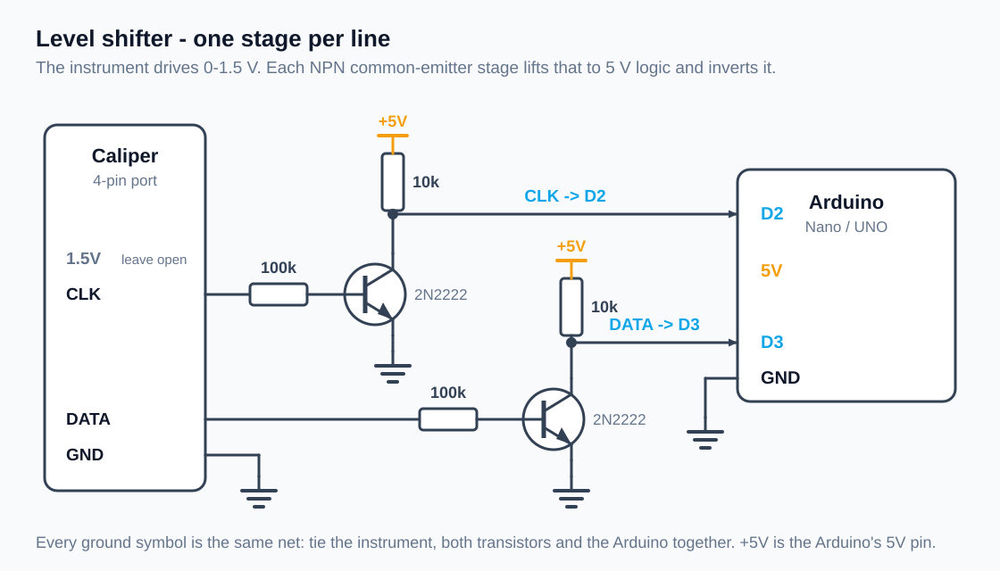

# Hardware

## Parts

| Qty | Part                                                      |
|-----|-----------------------------------------------------------|
| 1   | Arduino Nano (ATmega328) — an UNO works just as well       |
| 2   | NPN transistor, 2N2222 / BC547 / S8050                     |
| 2   | 100 kΩ resistor (base)                                     |
| 2   | 10 kΩ resistor (collector pull-up)                         |
| 1   | 4-pin connector matching your instrument's port            |
| 1   | piece of perfboard                                         |
| 1   | 16x2 LCD, I2C backpack — only for the LCD sketch           |
| 1   | push button — optional, zero / clear min-max on the LCD    |

Resistor values are not critical: 47 kΩ–100 kΩ on the base and 4.7 kΩ–10 kΩ
as the pull-up both work. Keep the base resistor large enough that the
instrument's weak output is not loaded down.

## Level shifter

The instrument's lines swing 0–1.5 V, which a 5 V ATmega will not read
reliably. One common-emitter NPN stage per line does the job: it is two
parts, tolerant of the exact levels, and needs no supply on the instrument
side. It **inverts** the signal, which the firmware undoes.

Build this twice — once for CLK, once for DATA:

The instrument's line drives the base through 100 kΩ. The collector sits at
5 V through the 10 kΩ pull-up and is pulled to ground whenever the
instrument's line goes high — that is where the inversion comes from. The
Arduino reads the collector.

Tie the instrument's GND to the Arduino GND. Leave the instrument's 1.5 V
pin unconnected — it is the cell, not an input.

## Connections

| Instrument | Through          | Arduino |
|------------|------------------|---------|
| CLK        | NPN stage        | D2      |
| DATA       | NPN stage        | D3      |
| GND        | direct           | GND     |
| +1.5 V     | leave open       | —       |

LCD sketch, I2C backpack:

| LCD | Nano |
|-----|------|
| SDA | A4   |
| SCL | A5   |
| VCC | 5V   |
| GND | GND  |

Optional button: one leg to D4, the other to GND. The pin uses the internal
pull-up, so no resistor is needed.

If you use a parallel HD44780 instead, set `USE_I2C_LCD` to `0` and wire
RS, E, D4, D5, D6, D7 to Arduino D12, D11, D10, D9, D8, D7 — D2 and D3 are
taken by the instrument.

## Build notes

* The shifter sits on a small piece of perfboard that the Nano plugs into,
  with the instrument on a 4-pin connector so it can be unplugged.
* Keep the wires to the instrument short. Long unshielded leads on a 1.5 V
  signal pick up enough noise to corrupt packets.
* Breadboard it first and confirm readings on the serial monitor before
  soldering anything.

## Troubleshooting

| Symptom                          | Likely cause                                   |
|----------------------------------|------------------------------------------------|
| Nothing at all                    | DATA and CLK swapped, or GND not shared        |
| Steady garbage / jumping numbers  | `SIGNAL_INVERTED` set the wrong way            |
| Readings out by 10x               | wrong `RESOLUTION` for your instrument         |
| Occasional wrong value            | noise — shorten leads, check solder joints     |
| Sign never goes negative          | instrument sends sign on bit 20 only in some   |
|                                   | modes; zero the instrument and try again       |
