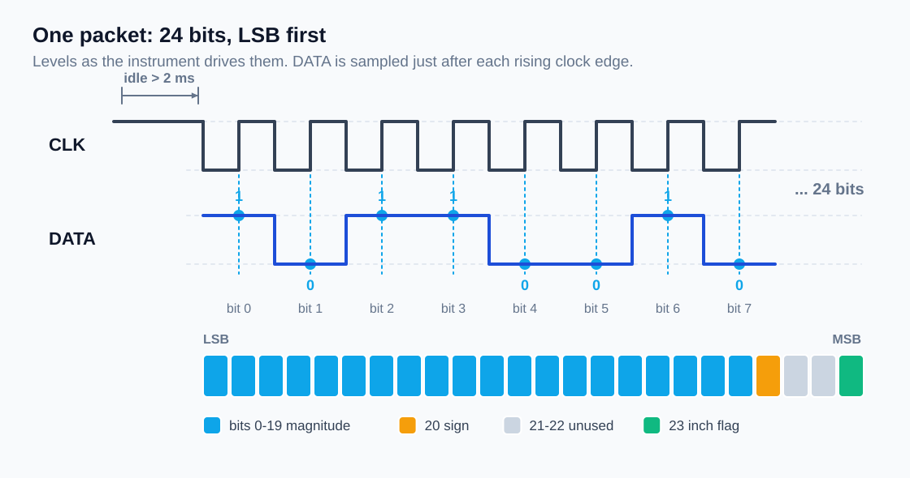

# Protocol

Almost every inexpensive Chinese digital caliper, dial indicator, micrometer
and tyre-depth gauge exposes the same 4-pin data port and speaks the same
24-bit serial format. This is what the firmware in this repository decodes.

## The port

Looking at the connector with the contacts facing you, from the edge of the
PCB inwards:

| Pin | Signal | Notes                                        |
|-----|--------|----------------------------------------------|
| 1   | +1.5 V | the cell voltage, do **not** feed 5 V in here |
| 2   | DATA   | ~1.5 V logic, driven by the instrument        |
| 3   | CLK    | ~1.5 V logic, driven by the instrument        |
| 4   | GND    | common ground with the Arduino                |

Pin order varies between models. If you get nothing, swap DATA and CLK
before you suspect the code.

## Levels and timing

The lines swing between 0 V and about 1.5 V. An ATmega328 running at 5 V
needs roughly 3 V to register a logic high, so the raw lines have to be
shifted first (see [hardware.md](hardware.md)). The transistor stage used
here inverts both signals; the firmware compensates with `SIGNAL_INVERTED`.

Observed on a 0.01 mm caliper:

* clock idles **high** between packets
* one packet = 24 clock pulses, bits a few hundred microseconds apart
* packets repeat every ~100-300 ms depending on the instrument and whether
  the slider is moving

The gap between packets is what the firmware uses to find the start of a
frame: if the clock has been quiet for `IDLE_GAP_US` (2 ms), the next edge
is bit 0.

## The 24-bit frame



Bits arrive **LSB first**. DATA is sampled just after the rising edge of the
clock.

| Bit(s) | Meaning                                            |
|--------|----------------------------------------------------|
| 0-19   | measurement magnitude, unsigned                    |
| 20     | sign: 1 = negative                                 |
| 21-22  | unused on the instruments tested                   |
| 23     | unit: 1 = inch, 0 = millimetre                     |

## Converting counts to a measurement

The magnitude is a raw count, not a distance. What one count is worth
depends on the instrument's resolution and the unit flag:

| Instrument           | mm mode        | inch mode        |
|----------------------|----------------|------------------|
| 0.01 mm (calipers)   | count / 100    | count / 2000     |
| 0.001 mm (indicators)| count / 1000   | count / 20000    |

Set `RESOLUTION` in the sketch to `100` or `1000` accordingly. Getting this
wrong shows up as readings that are out by a factor of ten.

Note that the inch counts are not the mm counts converted — the instrument
sends a different count in inch mode, so a relative zero taken in one mode
does not carry over to the other.

## Decoding, step by step

```
raw      = 24 bits, LSB first
inch     = raw & (1 << 23)
negative = raw & (1 << 20)
value    = raw & ((1 << 20) - 1)
if negative: value = -value
```

## Sources

The frame layout was worked out by others long before this project; this
document just records what was confirmed on the bench here. See the credits
in the main [README](../README.md).
